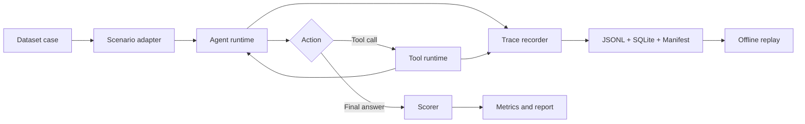

# Agent Playground Harness

[中文说明](README.zh-CN.md)

A small, local-first harness for running, tracing, replaying, and evaluating
single-agent experiments.

Agent changes are difficult to compare when model calls, tool results, context,
and evaluation logic are mixed together. This project keeps those boundaries
explicit and records enough evidence to answer three questions:

- Did the experiment improve?
- Where did a failed run break?
- Can the result be inspected again without calling the model or tools?

The standard demo is deterministic and offline. It compares a baseline with an
ablation over 20 repository-question tasks, writes integrity-checked artifacts,
and replays both a normal sample and a regression sample.

## Highlights

- Versioned, JSON-safe runtime and model contracts
- Schema-first tools with allowlists, timeouts, and normalized errors
- Deterministic context-window construction
- Append-only JSONL traces and a SQLite run index
- SHA-256 artifact integrity checks
- Offline replay without model or tool calls
- Deterministic scoring and baseline/ablation comparison reports
- Stable failure attribution across model, tool, context, runtime, storage, and trace integrity

## How It Works



The Eval runner uses the same production runtime as normal execution. Replay
loads finalized artifacts, verifies their hashes and byte counts, checks event
consistency, and reconstructs the run without external calls.

## Requirements

- Node.js 22.5.0 or newer
- npm 11 or newer
- Git

The project is currently validated on Windows with PowerShell.

## Quick Start

```powershell
git clone https://github.com/Xiaoxiaocaiii/MyPiiii.git
Set-Location MyPiiii
npm ci
npm run demo
```

The demo builds the project, runs both configurations, prints the comparison,
replays representative samples, and removes its temporary output directory.
Expected headline results are:

```text
Dataset: repo-qa-structure@v1
Baseline score pass rate: 1
Ablation score pass rate: 0.95
Regression samples: repo-qa-01
```

To keep the generated artifacts, choose a new output directory:

```powershell
New-Item -ItemType Directory -Force artifacts | Out-Null
npm run dev -- demo --output ./artifacts/demo-01
```

Replay a stored sample without calling a model or tool:

```powershell
npm run dev -- replay --demo ./artifacts/demo-01 --variant baseline --case repo-qa-01
npm run dev -- replay --demo ./artifacts/demo-01 --variant ablation --case repo-qa-01
```

## Artifacts

A persistent demo produces:

```text
demo-01/
|-- comparison-report.md
|-- demo-result.json
|-- baseline/
|   |-- eval-runs.sqlite
|   `-- YYYY-MM-DD/<session>/
`-- ablation/
    |-- eval-runs.sqlite
    `-- YYYY-MM-DD/<session>/
```

Each finalized session contains a Manifest, JSONL Trace, and final output.
Trace paths in reports are relative to their variant directory.

## Optional Real-Model Contract

The deterministic demo does not require credentials or network access. To run
the optional OpenAI adapter contract, create a local `.env` file:

```powershell
Copy-Item .env.example .env
```

Set `RUN_REAL_MODEL_TESTS=1`, `OPENAI_API_KEY`, and `OPENAI_MODEL`, then run:

```powershell
npm run test:real-model
```

`OPENAI_RESPONSES_ENDPOINT` can override the default Responses API endpoint.
The `.env` file is ignored by Git and loaded only by this explicit command.

## Quality

```powershell
npm run format:check
npm run lint
npm run typecheck
npm test
npm run test:integration
npm run test:fresh
npm run test:stability
npm run verify
```

The current release has 332 passing tests. Its latest local verification
reported 96.51% statement coverage and 90.35% branch coverage.

## Project Structure

```text
src/
|-- core/             # Config, runtime, model, tool, and context kernel
|-- observability/    # Trace capture, storage, integrity, and replay
|-- eval/             # Dataset, scorer, runner, metrics, and reports
|-- scenarios/        # Replaceable task-family adapters
|-- cli.ts
`-- bin.ts
test/unit/             # Unit and contract tests
scripts/               # Integration and release validation
docs/                  # Reproduction notes and design decisions
artifacts/             # Generated output; ignored except for its README
```

## Scope

This repository intentionally focuses on one local single-agent evaluation
loop. It does not provide:

- Web or HTTP APIs
- Multi-agent orchestration
- Long-term memory or RBAC
- Dynamic plugins or command-execution tools
- Remote artifact storage
- Token-level reproduction of remote model responses

Missing duration, token, price, or tool evidence is reported as `unavailable`;
it is never replaced with a fabricated zero.

See [release and reproduction](docs/release-and-reproduction.md) for the full
experiment identity, artifact layout, and known limitations. The decision to
keep the project CLI-only is recorded in
[the Web/API scope note](docs/web-api-decision.md).

## License

Released under the [MIT License](LICENSE).
